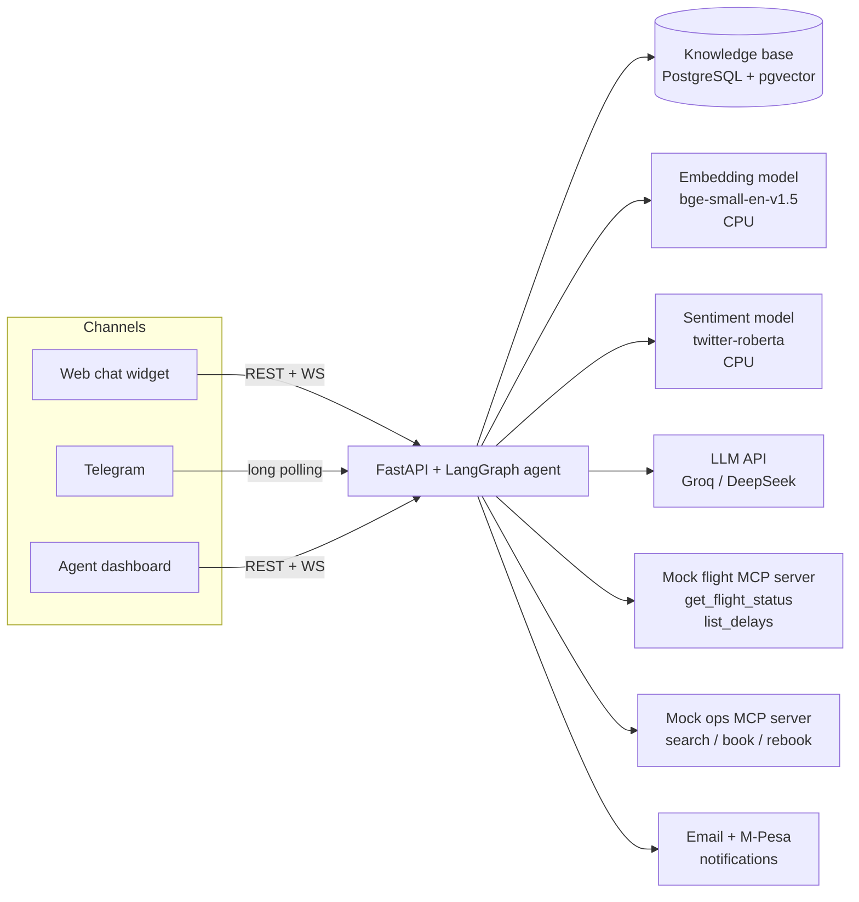

# Hermes — Kenya Airways support bot (prototype)

Hermes is a RAG-based passenger support assistant for Kenya Airways. It answers
policy, baggage, check-in, flight-status and rebooking questions, streams replies
over WebSocket, routes upset or high-risk conversations to a human agent
dashboard, and supports an in-chat booking → M-Pesa payment → e-ticket flow.

This is a prototype: the flight data is simulated and the operational systems are
mocked. See [Assumptions](#assumptions).

## Architecture



Full component details, request flow, and screenshots:
[docs/system-architecture.md](docs/system-architecture.md).

## Knowledge base

The seeded corpus is:

- **KQ self-rebooking FAQ PDF** — `data_sources/self-rebooking-faqs-info-.pdf`.
- **28 Kenya Airways web pages** covering baggage, check-in, managing a booking,
  refunds, special care, travel requirements and contact information — listed in
  [`data_sources/data_source1.txt`](data_sources/data_source1.txt).
- Optional documents uploaded from the agent dashboard (PDF/DOCX) or ingested by
  URL. Re-ingest is content-hash based, so unchanged sources are skipped.

An archived copy of the SAA Conditions of Carriage PDF is kept in
`data_sources/archive/`; it is not part of the default ingestion directory.

## MCP servers and tools

Both servers use the stdio transport.

| Server | Run | Tools |
|---|---|---|
| `hermes-flights` | `python -m services.flights_mcp` | `get_flight_status(flight_no, date?)`, `list_delays(route?, date?, min_delay?)` |
| `hermes-ops` | `python -m services.ops_mcp` | `search_flights`, `create_booking`, `rebook_flight`, `confirm_rebook`, plus agent-only `issue_ticket`, `mpesa_stk_push`, `verify_payment` |

The backend is a real MCP consumer: the LangGraph agent calls the flight tools
over MCP, and the ops tools back booking/rebooking. If a server is unavailable,
the same functions are called in-process so a turn does not fail. Set
`FLIGHTS_MCP_ENABLED=false` or `OPS_MCP_ENABLED=false` to skip the MCP path.

## Models

| Purpose | Model | Runtime |
|---|---|---|
| Embeddings | `BAAI/bge-small-en-v1.5` (384 dimensions) | CPU via `sentence-transformers` |
| Sentiment | `cardiffnlp/twitter-roberta-base-sentiment-latest` | CPU via `transformers` |
| Answering / intent | Groq `openai/gpt-oss-120b` with `openai/gpt-oss-20b` fallback; DeepSeek as backup | External OpenAI-compatible API |

Sentiment is a signed score in `[-1, 1]` (`P(positive) - P(negative)`). A score
below `-0.75` for two consecutive passenger turns is a soft escalation trigger.

## Workflow

```text
ingest (parse → chunk → embed) → pgvector
passenger turn → greeting check → sentiment → intent classification → route
  ├─ hard escalation (safety / explicit human request) → escalation queue
  └─ retrieve → flight lookup → baggage lookup → LLM answer (streamed)
       └─ soft escalation offers a "Connect me to a human" quick reply
agent dashboard → claim → reply / issue e-ticket → resolve
```

Booking adds `search_flights` → `create_booking` (held booking + pending payment)
→ payment card (M-Pesa phone captured browser-side) → payment callback/poller →
agent issues e-ticket. Rebooking runs through the ops MCP tools and can email a
confirmation.

## Run locally

### Docker (recommended)

```bash
cp .env.example .env          # set GROQ_API_KEY (or DEEPSEEK_API_KEY)
docker compose up --build -d
```

Open:

- Web app: <http://localhost:5173>
- API docs (Swagger UI): <http://localhost:8000/docs>

Compose starts PostgreSQL 16 + pgvector, ingests the knowledge base once, then
starts the API and frontend. The first startup downloads the CPU models and can
take several minutes:

```bash
docker compose logs -f kb-init
docker compose logs -f backend
```

### Without Docker

Prerequisites: Python 3.11, Node 18+, PostgreSQL 16 with the `pgvector`
extension, and an LLM API key.

```bash
# 1. Database
sudo -u postgres psql -c "CREATE DATABASE hermes;"
sudo -u postgres psql -c "ALTER USER postgres PASSWORD 'postgres';"

# 2. Backend
cp .env.example .env            # set GROQ_API_KEY or DEEPSEEK_API_KEY
python -m venv .venv && source .venv/bin/activate
pip install -r requirements.txt
python -m ingest.run --embed    # populate the knowledge base
uvicorn app.main:app --reload   # http://localhost:8000

# 3. Frontend
cd frontend
npm install
npm run dev                     # http://localhost:5173
```

To force a full re-embed or rebuild the corpus:

```bash
python -m ingest.run --embed --force
python -m ingest.run --embed --reset
```

## Assumptions and prototype limits

- **Mock operational data.** The MCP servers and tool calls read mock SQLite
  data. They mimic the shape of Kenya Airways systems but are not connected to
  the real ones and are nowhere near as complete.
- **Small schedule.** Only a handful of invented routes and flights are seeded
  (for example NBO–LHR, NBO–DXB, NBO–MBA).
- **One-way flights only.** Fares are a flat demo amount; no return itineraries.
- **Simulated delays.** Delay status is generated from a date-seeded RNG and is
  stable for a calendar day.
- **Email fallback.** Without `RESEND_API_KEY`, confirmation emails are written
  to the local `.mock_emails/` outbox.
- **Payments.** With no Daraja credentials, the M-Pesa provider runs in simulated
  mode. Numbers ending `0000` fail and `1111` cancel.
- **Not production-ready.** Default secrets, no rate limiting, and local-only
  ports are intentional for the prototype.

## Documentation

- [System architecture](docs/system-architecture.md) — components, flow, data,
  configuration, testing, screenshots.
- [API reference](docs/api.md) — REST endpoints, WebSocket protocols, payment
  and escalation flows.

Contributor workflow: [CONTRIBUTING.md](CONTRIBUTING.md).
