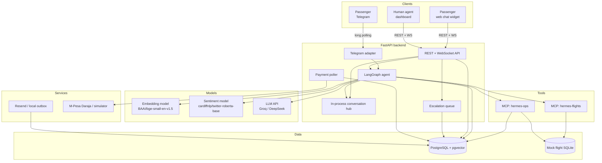
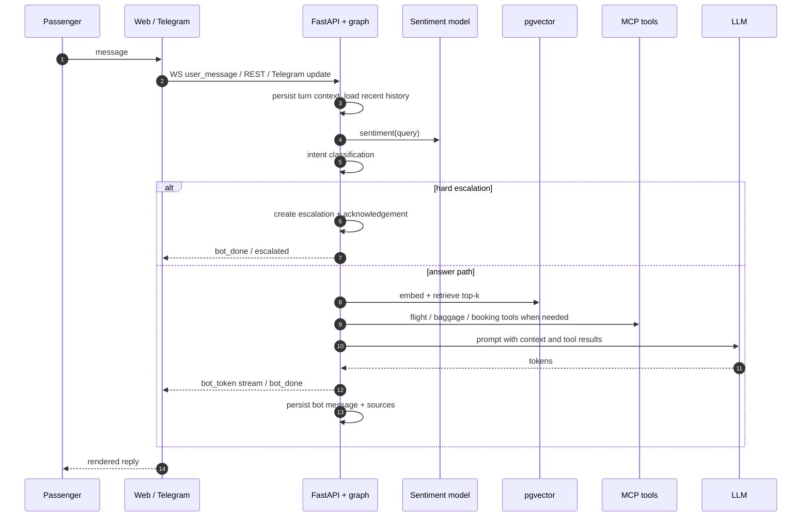
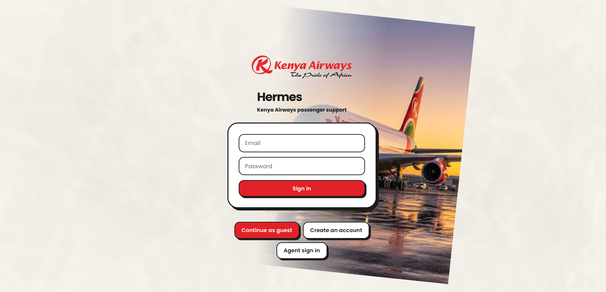
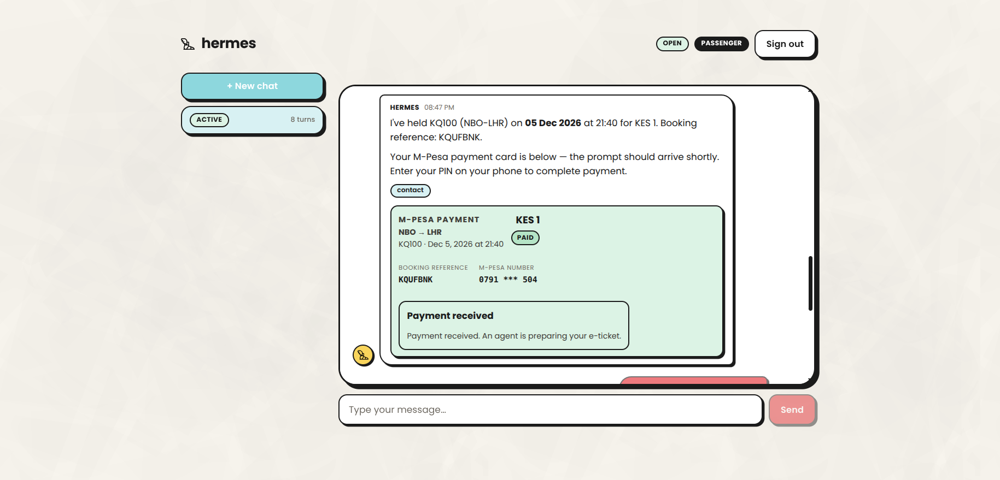
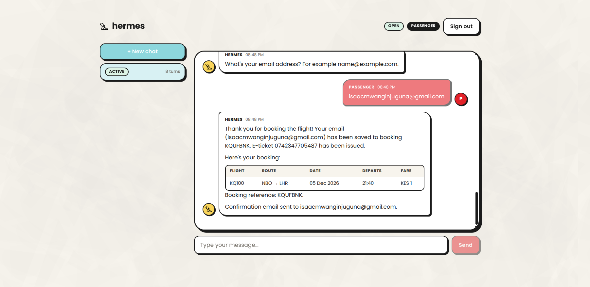
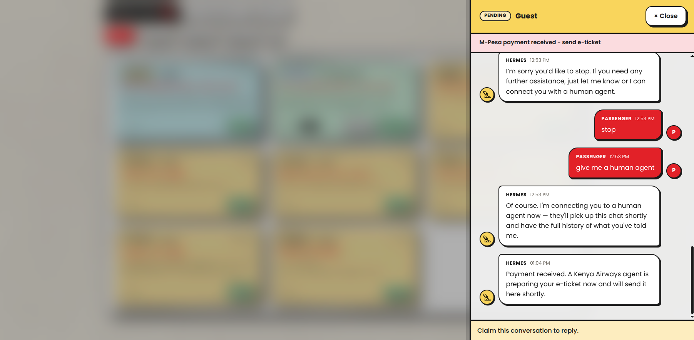
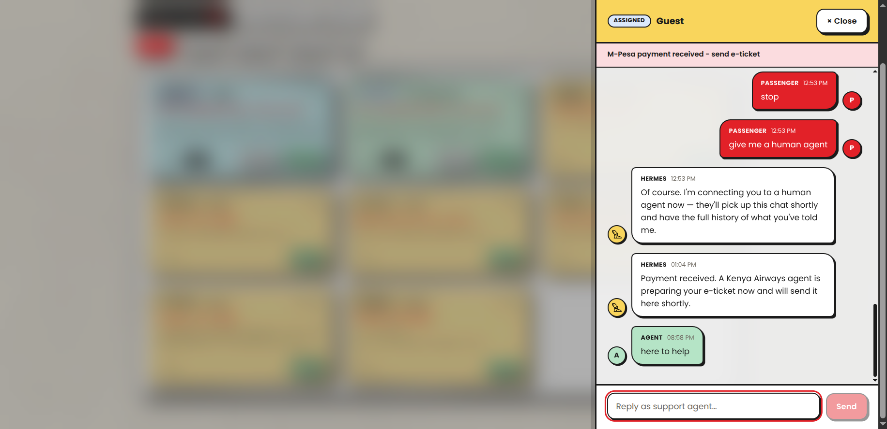
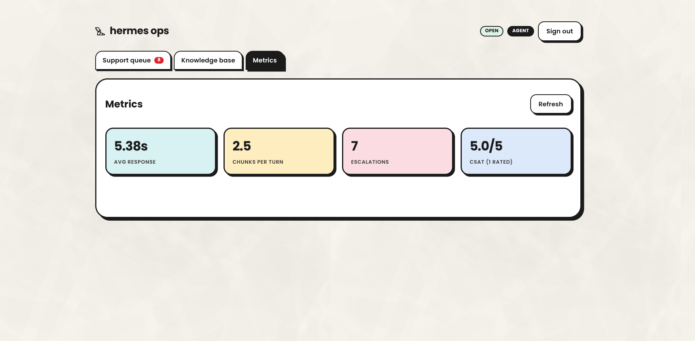
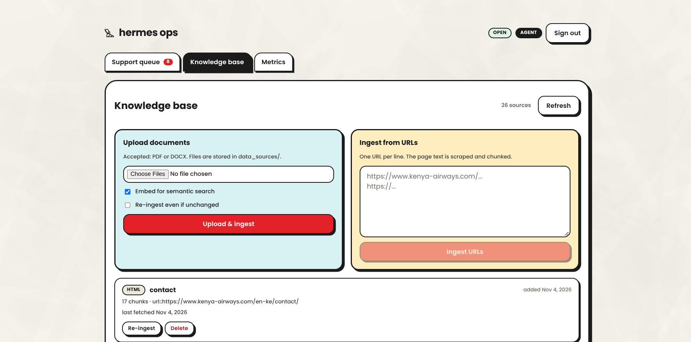
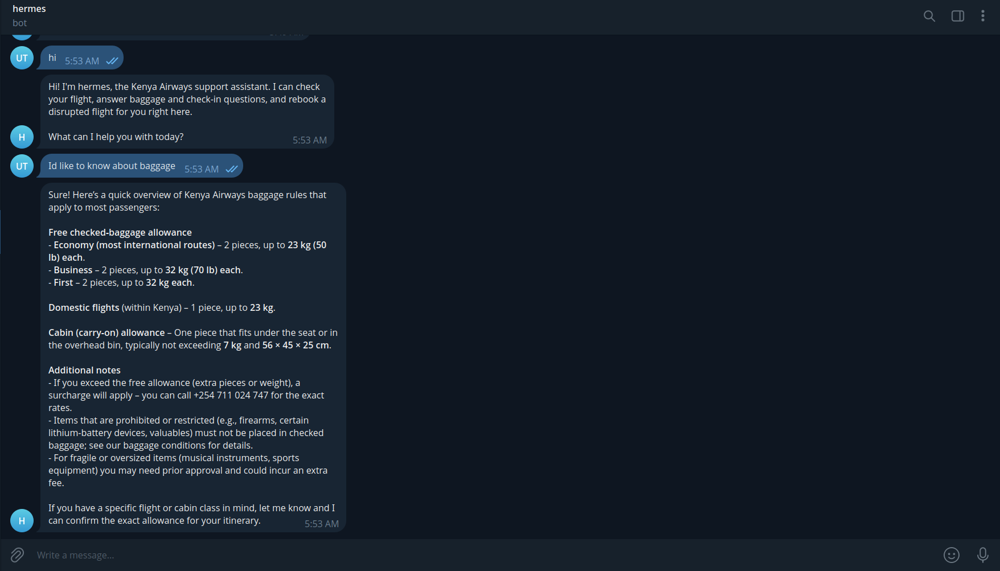

# System architecture

Hermes is a prototype passenger-support platform for Kenya Airways. This
document describes how the pieces fit together, the conversation and escalation
flows, the knowledge-base pipeline, the model choices, and the operational
assumptions. API contracts are documented separately in [api.md](api.md).

> **Prototype notice:** flight schedules, bookings, payments, and operational
> tools are simulated. Nothing here connects to live Kenya Airways systems.

## 1. System context



## 2. Runtime components

### Backend API

A single FastAPI application exposes REST endpoints and two WebSocket channels:

- passenger chat: `/ws/conversations/{conversation_id}`
- agent dashboard queue updates: `/ws/dashboard`

In the container image the same process also serves the built React app, so
API, WebSocket, and UI share one origin. During local development Vite proxies
`/api` and `/ws` to the backend.

### Agent graph

The conversation pipeline is a compiled LangGraph state machine. It is the only
path used for a turn, whether the message arrives over WebSocket, the REST
fallback, or Telegram.

| Node | Purpose |
|---|---|
| `dispatch` | Answers standalone greetings deterministically, before retrieval. |
| `analyse_sentiment` | Scores the message with the CPU sentiment model. |
| `classify` | Combines keyword safety checks with an LLM intent classifier. |
| `route` | Applies hard and soft escalation rules, or continues to retrieval. |
| `retrieve` | Embeds the query and retrieves top-k chunks from pgvector. |
| `flight_lookup` | Resolves flight-status/delay questions through MCP tools. |
| `baggage_lookup` | Adds deterministic lost/delayed-baggage guidance. |
| `generate_answer` | Calls the LLM, streaming tokens when requested, and may run booking/rebooking tool loops. |
| `handle_escalation` | Creates the escalation row and sends a hand-off acknowledgement. |

### Frontend

A React app with two surfaces:

- **Passenger chat widget**: conversation list, streamed bot replies, quick
  replies, payment cards, CSAT prompt.
- **Agent dashboard**: escalation queue, claim/release/resolve, transcript,
  reply box, e-ticket action, knowledge-base management, metrics.

### Telegram adapter

When `TELEGRAM_BOT_TOKEN` is set, a long-polling adapter starts inside the
backend. Each Telegram chat maps to one passenger and one conversation. Agent
replies from the dashboard are relayed into the Telegram chat through the same
in-process conversation hub used by WebSockets.

### Stores

- **PostgreSQL + pgvector** for conversations, messages, escalations, users,
  bookings, payments, metrics, and embedded knowledge fragments.
- **SQLite** (`.flights.sqlite`) for the mock flight schedule. It is a cache of
  the current day's deterministic delay roll and is regenerated when the date
  changes.

### External services

- **LLM**: Groq is primary (`openai/gpt-oss-120b`, fallback
  `openai/gpt-oss-20b`); DeepSeek is the configured backup.
- **Email**: Resend when `RESEND_API_KEY` is set; otherwise a local outbox.
- **M-Pesa**: Safaricom Daraja when credentials are configured; otherwise a
  deterministic simulator.

## 3. Turn lifecycle



### Escalation model

- **Hard escalation** happens immediately for safety terms and explicit
  "speak to a human" requests. The passenger still receives an acknowledgement.
- **Soft escalation** fires for compensation requests, a sustained negative
  sentiment streak, or a conversation that remains unresolved after
  `MAX_LOOP_TURNS`. The bot answers first and attaches a "Connect me to a
  human" quick reply. After `SOFT_ESCALATION_MAX_OFFERS` unanswered offers it
  hands off anyway.
- Escalations land in the agent queue as `pending`. An agent claims one
  atomically (`pending → assigned`), can release it, and resolves it when done.
  Claim/release/resolve broadcast `queue_update` events to all dashboards.

## 4. Knowledge base

### Sources

The default corpus contains:

- `self-rebooking-faqs-info-.pdf` — KQ self-service rebooking FAQ.
- 28 Kenya Airways web pages listed in `data_sources/data_source1.txt`,
  covering baggage, check-in, booking management, refunds, special care,
  travel requirements, and contact information.
- Documents uploaded through the dashboard (PDF/DOCX, max 50 MB each).
- URLs added through the dashboard.

The archived SAA Conditions of Carriage PDF in `data_sources/archive/` is not
part of the default discovery directory.

### Ingestion pipeline

```text
source (PDF / DOCX / HTML / text)
  → parse
  → chunk
  → embed (bge-small-en-v1.5, 384 dims, normalised)
  → store document + fragments + vector in PostgreSQL
```

- Documents are deduplicated by SHA-256 content hash. Unchanged sources are
  skipped unless `--force` or the dashboard's "re-ingest" action is used.
- URL sources are fetched with Chrome TLS impersonation because the KQ site
  rejects some plain HTTP clients.
- If a remote source is unavailable, ingestion logs a warning and the rest of
  the corpus is still usable.
- If the embedding stack is unavailable, the retriever falls back to keyword
  search instead of failing the turn.

The Docker Compose `kb-init` service runs ingestion once before the API starts.
The backend also warms the embedding model and store connection at startup so
the first passenger turn is not delayed by model loading.

## 5. Models

| Stage | Model | Notes |
|---|---|---|
| Embeddings | `BAAI/bge-small-en-v1.5` | CPU, `sentence-transformers`, 384 dimensions, normalised vectors. |
| Sentiment | `cardiffnlp/twitter-roberta-base-sentiment-latest` | CPU, `transformers`; emits negative/neutral/positive probabilities. |
| Intent | Groq `openai/gpt-oss-120b` | Structured single-word classification; falls back to `routine` on error. |
| Answers | Groq `openai/gpt-oss-120b` → `openai/gpt-oss-20b` → DeepSeek | Streaming via OpenAI-compatible API. |

Sentiment score is `P(positive) - P(negative)` in `[-1, 1]`. A score below
`SENTIMENT_ESCALATION_THRESHOLD` (default `-0.75`) for
`SENTIMENT_ESCALATION_CONSECUTIVE_TURNS` (default `2`) consecutive passenger
turns contributes a soft escalation trigger.

## 6. MCP servers and tools

Both MCP servers use the stdio transport and wrap the same in-process service
functions the backend can fall back to.

### `hermes-flights`

Run: `python -m services.flights_mcp`

| Tool | Arguments | Returns |
|---|---|---|
| `get_flight_status` | `flight_no`, optional `date` (`YYYY-MM-DD`) | One flight's status, route, times, delay, date. |
| `list_delays` | optional `route`, `date`, `min_delay` (default 15) | Delayed flights, worst first. |

The schedule is 17 invented flights (for example NBO–LHR, NBO–DXB, NBO–MBA).
Delays are generated from a date-seeded RNG, so results are stable for a
calendar day and change the next day.

### `hermes-ops`

Run: `python -m services.ops_mcp`

| Tool | Purpose | LLM-visible |
|---|---|---|
| `search_flights` | Search the mock schedule for a route and date. | Yes |
| `create_booking` | Create a held booking and a pending payment row. | Yes |
| `rebook_flight` | Rebook a passenger onto a new date/flight. | Yes |
| `confirm_rebook` | Confirm the chosen alternative and email the new ticket. | Yes |
| `issue_ticket` | Issue an e-ticket for a paid booking. | No (agent action) |
| `mpesa_stk_push` | Low-level STK push entry point. | No (payment card path) |
| `verify_payment` | One-shot payment status lookup. | No (poller/callback path) |

If `FLIGHTS_MCP_ENABLED=false` or `OPS_MCP_ENABLED=false`, the backend calls the
same functions in-process. If a server fails to start, the tool layer falls back
automatically.

## 7. Booking, payment, and rebooking

### Booking and M-Pesa

1. The agent graph searches flights and calls `create_booking`, which creates a
   `held` booking plus a `pending` payment row and returns a `payment_id`.
2. The bot message carries the `payment_id`; the chat renders an M-Pesa card.
3. The passenger enters a phone number in the card. The browser posts it to
   `POST /chat/payments/{id}/phone`. The number never enters the LLM prompt.
4. The backend normalises the number, starts the STK push, and schedules a
   background poller.
5. Payment resolves by either:
   - Daraja callback at `POST /daraja/callback`, or
   - polling every `MPESA_STK_QUERY_INTERVAL_SECONDS` for
     `MPESA_STK_QUERY_MAX_ATTEMPTS`.
6. On success the booking becomes `paid`, the passenger is notified, and the
   conversation enters the human queue for ticketing.
7. The agent issues the e-ticket from the dashboard; the booking becomes
   `ticketed` and open payment cards update in place.
8. The card can also collect an optional email address
   (`POST /chat/payments/{id}/email`) to send the e-ticket copy.

With `MPESA_PROVIDER=simulated` (or `auto` without Daraja credentials), a
simulated prompt resolves after `MPESA_SIMULATE_DELAY_SECONDS`. Numbers ending
`0000` fail and `1111` cancel.

### Rebooking

The bot offers both the official KQ self-service page and an in-chat rebooking.
The in-chat path collects a booking reference/PNR/e-ticket number once, picks
the next available flight if no date is given, records the rebooking against the
mock schedule, and emails a confirmation when an address is on file. An unknown
reference still rebooks but sends no email.

## 8. Authentication and roles

- Passengers can register with email + password, log in, or start an anonymous
  guest session. Passwords are hashed with bcrypt.
- Agents have per-agent accounts (email + password), plus an env-defined
  bootstrap account (`AGENT_USERNAME` / `AGENT_PASSWORD`) auto-created on first
  login.
- JWTs carry `sub` (user id) and `role` (`passenger` or `agent`). The same token
  is used for REST (`Authorization: Bearer …`) and WebSocket (`?token=…`).
- `POST /auth/refresh` exchanges a still-valid token for a fresh one.
- Agent WebSocket access to a conversation requires the matching claimed
  escalation; dashboard sockets require an agent token.

## 9. Data model

| Table | Purpose |
|---|---|
| `passengers` | Registered and anonymous passengers. |
| `agents` | Human-agent accounts. |
| `conversations` | Passenger thread, status, turn count, soft-offer count, extracted facts. |
| `messages` | Transcript with sender, sentiment, sources, quick replies, payment link. |
| `escalations` | Queue entry with reason, summary, status, assigned agent. |
| `knowledge_documents` | Source metadata and content hash. |
| `knowledge_fragments` | Chunk text, topic, source URL, 384-dim embedding. |
| `bookings` | PNR, passenger/flight/date, booking status, e-ticket number. |
| `payments` | PNR, amount, phone, Daraja ids, status, receipt, raw payload. |
| `performance_metrics` | Response time, retrieval hits, CSAT, escalation counts. |
| `rebook_email_map` | Prototype mapping from ticket/reference to confirmation email. |

## 10. Configuration

Configuration is environment-driven (`pydantic-settings`, `.env`). The important
groups are:

| Group | Key settings |
|---|---|
| Database | `DATABASE_URL`, pool sizes, `KB_CACHE_TTL_SECONDS` |
| Auth | `SECRET_KEY`, `ACCESS_TOKEN_EXPIRE_MINUTES`, `AGENT_USERNAME`, `AGENT_PASSWORD` |
| LLM | `GROQ_API_KEY`, `DEEPSEEK_API_KEY`, `LLM_MODEL`, `LLM_FALLBACK_MODEL`, `LLM_TIMEOUT_SECONDS`, `LLM_MAX_RETRIES` |
| Models | `EMBEDDING_MODEL`, `SENTIMENT_MODEL`, `SENTIMENT_ESCALATION_THRESHOLD`, `SENTIMENT_ESCALATION_CONSECUTIVE_TURNS` |
| Retrieval | `RETRIEVER_K`, `CONTEXT_MAX_CHARS` |
| Escalation | `SOFT_ESCALATION_ENABLED`, `SOFT_ESCALATION_MAX_OFFERS`, `ESCALATE_ON_COMPENSATION`, `MAX_LOOP_TURNS` |
| Channels | `CORS_ORIGINS`, `TELEGRAM_BOT_TOKEN`, `TELEGRAM_POLL_TIMEOUT` |
| MCP | `FLIGHTS_MCP_ENABLED`, `OPS_MCP_ENABLED`, `FLIGHTS_DB_PATH` |
| Payments | `MPESA_PROVIDER`, Daraja credentials, callback URL/secret, poll interval/attempts |
| Email | `RESEND_API_KEY`, `RESEND_FROM_EMAIL`, `EMAIL_OUTBOX_DIR`, `REBOOK_CONFIRMATION_EMAIL` |

See [`.env.example`](../.env.example) for the full list and defaults.

## 11. Deployment and operations

Docker Compose runs:

1. **db** — PostgreSQL 16 with pgvector.
2. **kb-init** — one-shot ingestion; exits 0 even if a remote source fails.
3. **backend** — FastAPI; waits for a healthy database and completed ingestion.
4. **frontend** — built React app served by Nginx.

Persistent named volumes hold PostgreSQL data, the flight SQLite database, the
email outbox, the Hugging Face model cache, and knowledge-source uploads.
Bundled source documents are refreshed from the image on each start; uploaded
files stay in the volume.

Health check: `GET /health`. In production, keep `.env` secrets out of image
builds and change the default credentials before exposing the app.

## 12. Testing and evaluation

```bash
python -m pytest tests/ -q          # unit suite
ruff check app services tests       # lint gate
python -m evals.run                 # golden-set evaluation (live backend)
python -m evals.run --fast          # quick subset
python tests/e2e_ws.py              # live WebSocket smoke test
python tests/mcp_flights_smoke.py   # live MCP smoke test
```

The evaluation harness sends each golden case through the live HTTP API and
scores answers deterministically (must-include/must-avoid terms, escalation, and
citation checks). It exits non-zero if a case fails, so CI can gate on it.

## 13. Screenshots

### Passenger login



### Passenger chat with in-chat M-Pesa payment card



### Booking confirmation and e-ticket



### Agent queue — pending escalation



### Agent conversation — claimed and replying



### Agent metrics



### Knowledge-base management



### Telegram channel — baggage answer



## 14. Assumptions and limitations

- **Mock operational data.** MCP servers and tools read mock SQLite data that
  mimics the shape of Kenya Airways systems but is not connected to them and is
  far less complete than the real systems.
- **Small, invented schedule.** Only a handful of routes/flights are seeded.
- **One-way flights only.** Fares are a flat demo amount.
- **Deterministic delays.** Status is stable per calendar day and regenerated
  the next day.
- **No real payments.** Daraja is optional; the simulator is the default.
- **Email fallback.** Without Resend credentials, confirmations go to a local
  outbox directory.
- **Prototype security.** Default secrets, no rate limiting, and localhost-bound
  ports are intentional for local evaluation.
